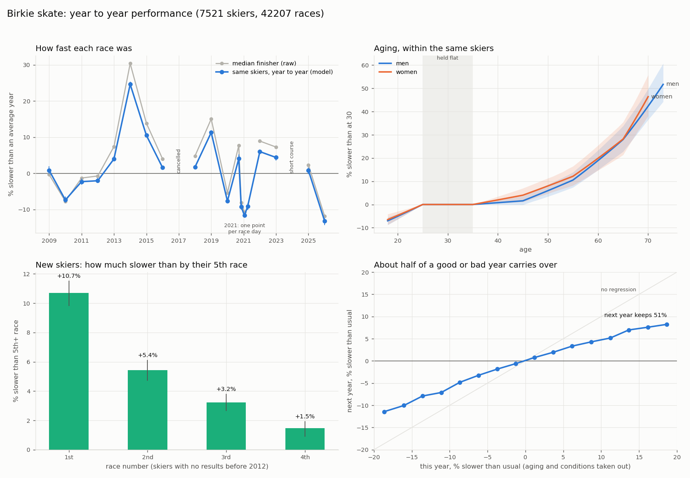
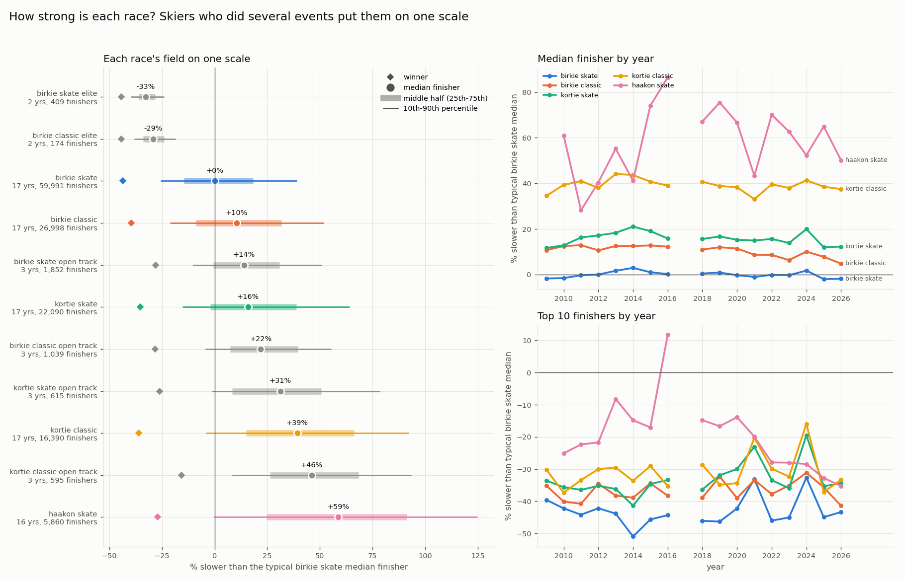
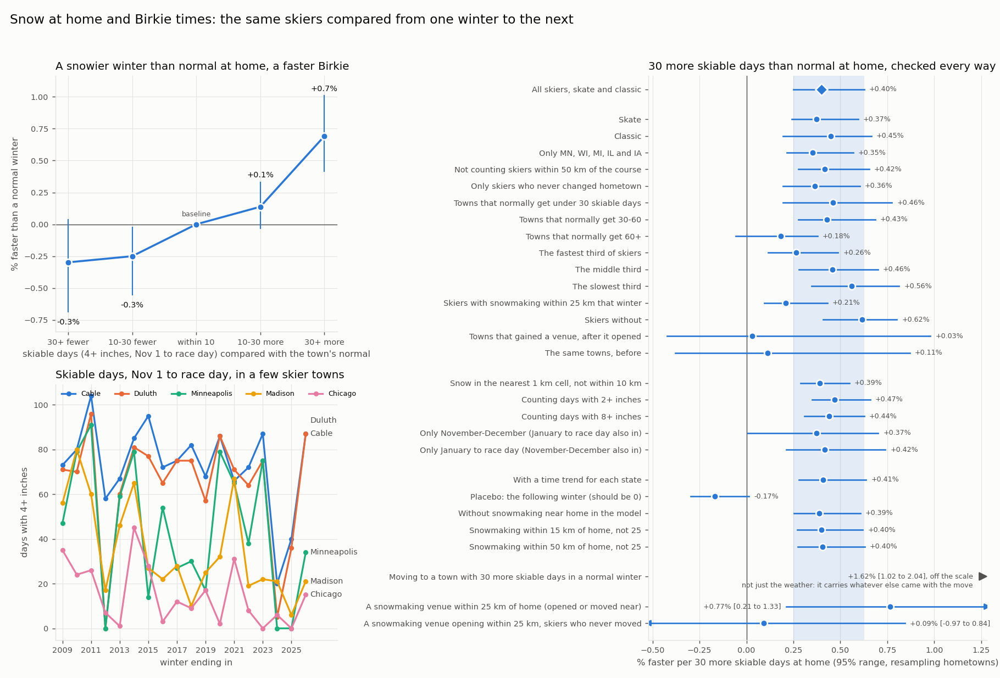
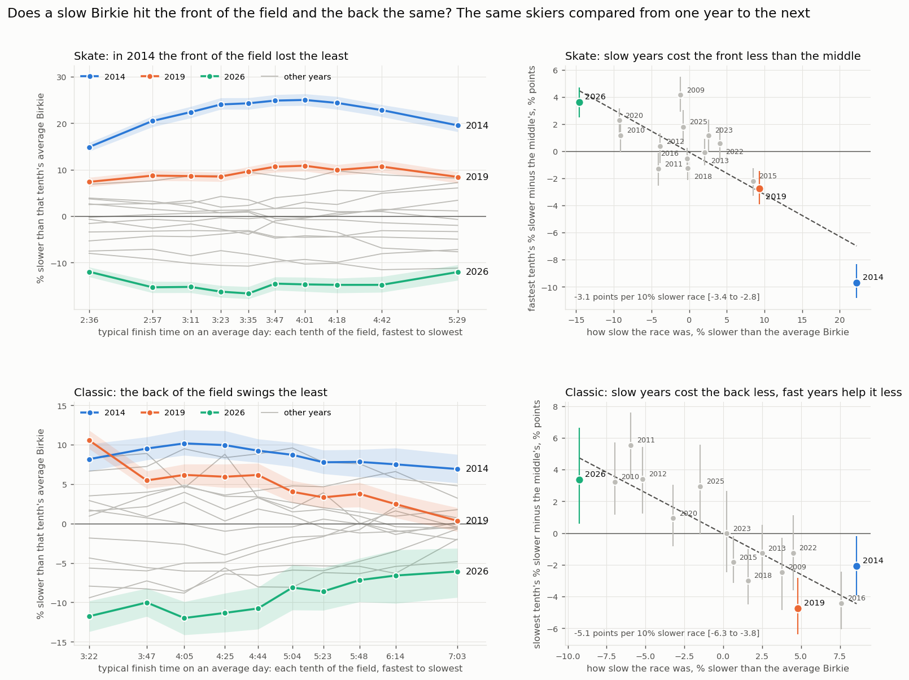
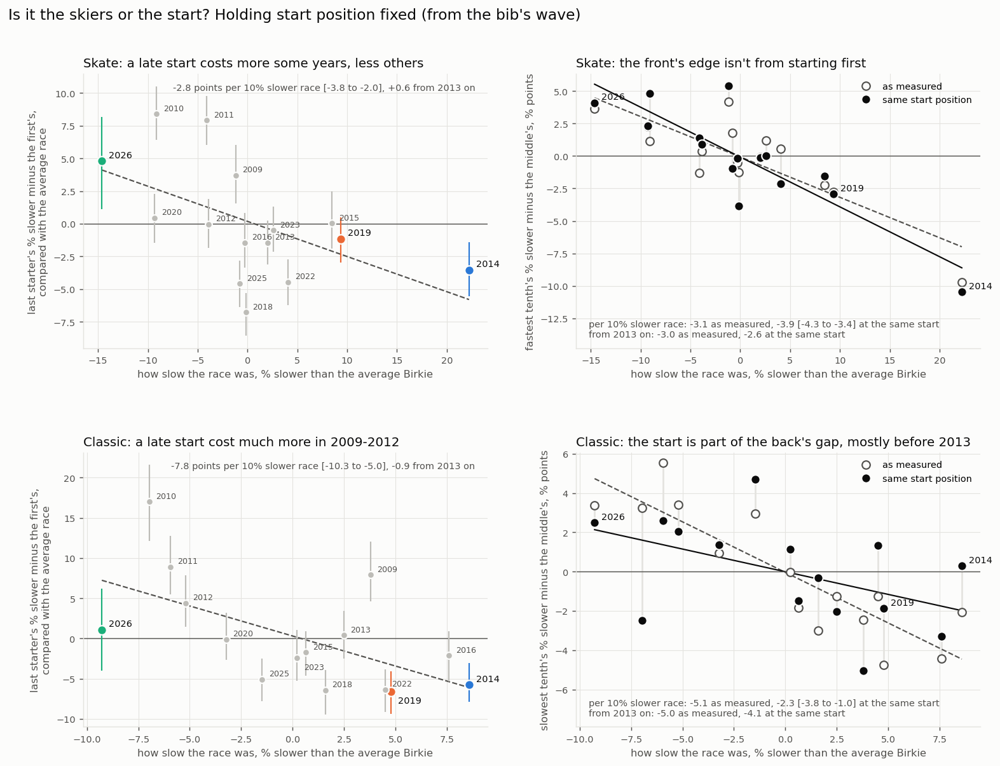
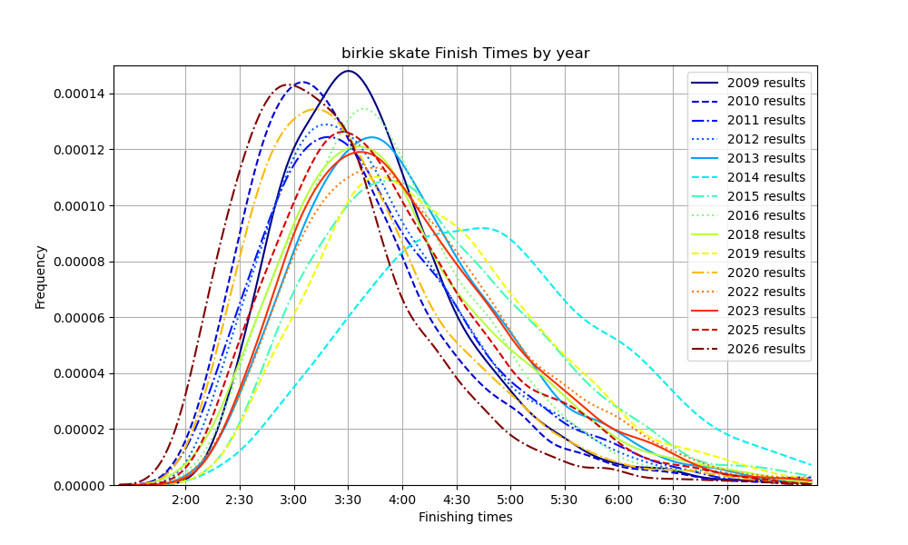
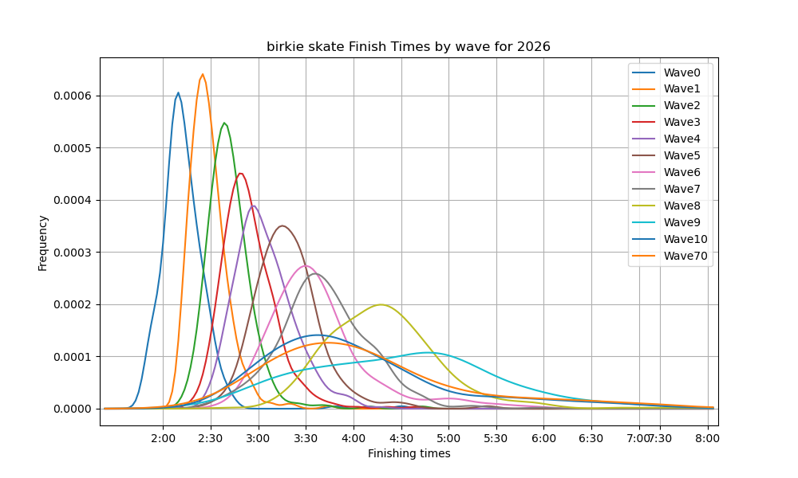
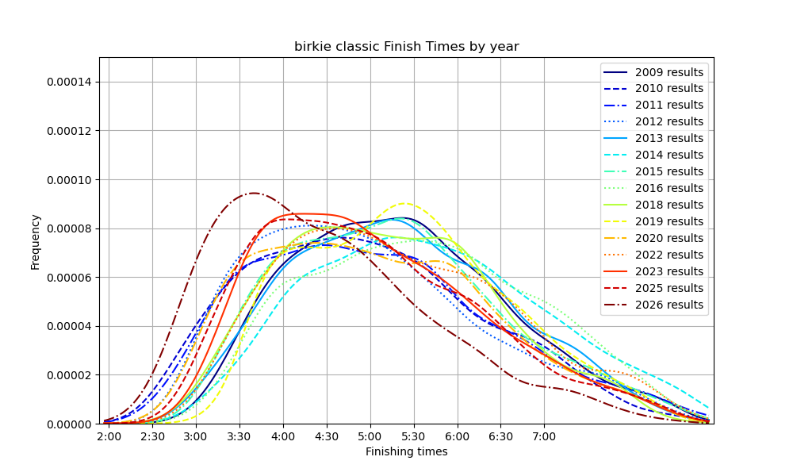
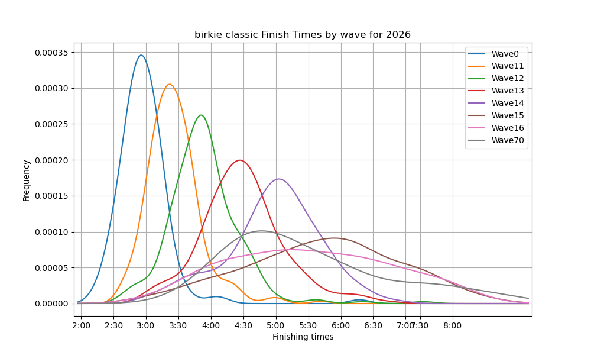

Birkie and Kortie results and some plots

Example usage:
python birkie_data_plotting.py  --tech skate --length birkie --plot byWave

Linking skiers from year to year:

python athlete_linking.py                         writes linked_data/linked_results.csv and linked_data/athletes.csv
python athlete_linking.py --name "drew polasky"   prints one skier's linked history

`results_loader.py` reads every file in yearly_data/ (four different formats since 2009) into one table.
`athlete_linking.py` gives each result an `athlete_id`. There are no ids in the results, so it matches on name
(with nicknames like Drew/Andrew), birth year (age group 2016-2020, exact age 2021+), gender, middle initial
(2009-2014) and hometown, and never on finish times. Each result also gets a `link_score` (log odds of its strongest
link) and `name_shared` (how many athletes share that exact name), to filter out shakier links in an analysis.

Year to year performance changes:

python performance_changes.py --race birkie --tech skate                        writes graphs/birkie_skate_year_to_year.png
python performance_changes.py --race birkie --tech skate --name "drew polasky"  also plots one skier, adjusted for conditions

`performance_changes.py` models log(finish time) as the skier's ability + that race's conditions + age + experience,
fit within the same skiers from year to year. Age is held flat from 25 to 35 and learning is assumed done by the 5th
race, which is what lets conditions and aging be told apart. 2024 (short course) and the open track are left out.

Field strength of each race:

python race_strength.py         writes graphs/race_strength.png, linked_data/crossover_results.csv and linked_data/race_strength.csv

Skiers who have done several events (Birkie, Kortie, Haakon, skate and classic, open track) put every race on one scale:
one ability per skier across events, one effect per race for its course and snow, plus age and experience. Each
race's winner, median and spread are then quoted as % slower than the typical Birkie skate median finisher.
`crossover_results.csv` has every finish by a multi-event skier with % of median, % back of the winner and of the top 10.
The Haakon is shaky: many adults there are skiing with their kids rather than racing.

Snow at skiers' hometowns:

python snow_depth.py download --start 2023-01-01 --end 2026-03-31     daily SNODAS tars from NSIDC, October to March
python snow_depth.py build                                             writes snow_data/hometowns.csv and snow_data/hometown_snow_depth.parquet

SNODAS is NOAA's daily 1 km snow model for the lower 48 (NSIDC dataset G02158). `build` places every US hometown in
the results with the Census gazetteer and USGS place names (downloaded on first use), then reads snow depth out of the
daily tars (`--tars`, E:/snowdas_data by default) for every day October to March since January 2004. Each hometown
gets the depth in its nearest 1 km land cell (`depth_mm`) and the average over land within 10 km (`depth_10km_mm`).
Only cells that are land in every season are used, since SNODAS's lake and border mask changed in 2013. Results
join to `hometowns.csv` on city and state. Hometowns outside the lower 48 have no SNODAS data.

Does snow at home make for a faster Birkie?

python snow_effect.py       writes graphs/snow_at_home.png and linked_data/snow_performance.csv

Counts each skier's skiable days at home (4+ inches within 10 km) from November 1 to the day before the race, and adds
them to the year to year model, split into the town's normal winter and how far this winter was above or below it.
The race's conditions take out everything the whole field shared that year, so the winter effect comes only from
skiers whose winter at home was snowier or leaner than normal there, compared with skiers from other places in the
same race. A winter with 30 more skiable days than normal is worth about 0.4% (0.2-0.6%), well under a minute for a
3 hour skier. It holds for skate and classic, without the local skiers, for skiers who never moved, with every
definition of a skiable day, and with a time trend for each state. The following winter's snow, which can't have
helped (a placebo), shows no gain (-0.15%, -0.31 to 0.00). The gain is biggest in towns that normally get little
snow and for slower skiers, and close to zero in towns that already get 60+ days. Moving somewhere with 30 more
skiable days in a normal winter goes with being 1.7% faster, but that includes whatever else came with the move.

Front vs back of the field:

python front_back.py        writes graphs/front_back.png, graphs/front_back_start.png, linked_data/front_back.csv
                            and linked_data/front_back_start.csv

Gives each race its own conditions effect for each tenth of the field, by typical finish time on an average day,
still measured within the same skiers from year to year. Everyone slower by the same % already spreads the field out
in minutes: 2014's skate field was 183 minutes from the 10th to the 90th percentile finisher against 146 in an average
year, but as a ratio 1.91 against 1.88. On top of that, in skate the front's times swing less with conditions than
the middle's. In 2014 the fastest tenth (2:35 skiers) lost 15%, the middle 25% and the slowest tenth 20%. Across all
races the fastest tenth loses about 3 points less than the middle per 10% slower race (2 without 2014), and gains less
in fast years like 2026. In classic it's the back that swings least, about 5 points less per 10% slower race (3 with
each skier's tenth set from their other races only), in fast years as well as slow, so it isn't just the time limit
cutting off the slowest. 2014 hit the classic field about evenly. Only finishers count, and DNFs aren't in the results
before 2023, so the back may look better than it was in slow years. The back of the skate field has also drifted slower
than the middle over the years, which can't be told apart from slower skiers aging faster.

The waves are seeded by speed, so the front also starts first. The bib gives the wave (one per thousand: elite under
1000, then skate waves 1000s-10000s and classic waves 11000s-19000s), and from that each skier's start position, the
share of the field that started ahead of them. Seeding lags a year and first-timers start at the back, so skiers of
the same speed start in different places, and a second model gives each race its own cost of starting later. With
start position held fixed the skate front's edge stays (-3.9 points per 10% slower race, -10.5 in 2014): it's the
skiers, not the fresh course. A late start cost a lot in 2009-2012, most of all in classic (17% between the first and
last starter in 2010), and a little less than usual since. Those early years were mostly fast ones, which is why
across all races a late start looks dearer in fast years, but from 2013 on it doesn't follow how fast the race was in
either technique. So the classic back's steadiness is mostly the skiers too: from 2013 on its gap is -5.0 points per
10% slower race as measured and -4.1 at the same start. Start position also stands for time of day and how many
skiers went by first, which can't be told apart here.

A plain check without the start position model gives the same answers. Each result is set against the skier's own
usual from their other races, through the simple year to year model only, and skiers of the same speed are split by
where they started, each race read against the average race. Race by race, late starters' extra loss matches the
model's start cost (correlation 0.90 skate, 0.94 classic). In 2014 skate, fast skiers (the fastest fifth) who started
mid-pack lost 18% (23 skiers), about the same as fast skiers who started up front (17%) and well under the middle
fifth around them (24%). The few middle fifth skiers who started up front didn't do better (27%, 14 skiers).

Birkie Skate finish times by year: 

Birkie Skate Waves 2026: 

Birkie Classic by year: 

Birkie Classic Waves 2026: 

