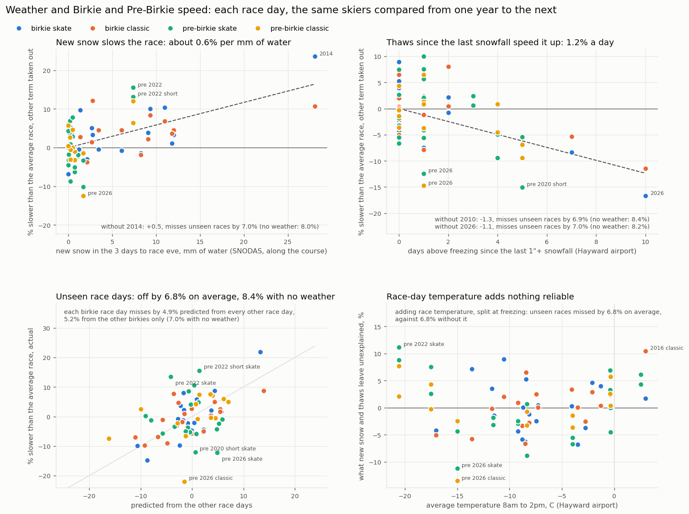

Birkie and Kortie results and some plots

Example usage:
python birkie_data_plotting.py  --tech skate --length birkie --plot byWave

Linking skiers from year to year:

python athlete_linking.py                         writes linked_data/linked_results.csv and linked_data/athletes.csv
python athlete_linking.py --name "drew polasky"   prints one skier's linked history

`results_loader.py` reads every file in yearly_data/ (four different formats since 2009) into one table.
`athlete_linking.py` gives each result an `athlete_id`. There are no ids in the results, so it matches on name
(with nicknames like Drew/Andrew), birth year (age group 2016-2020, exact age 2021+), gender, middle initial
(2009-2014) and hometown, and never on finish times. Each result also gets a `link_score` (log odds of its strongest
link) and `name_shared` (how many athletes share that exact name), to filter out shakier links in an analysis.

Birkie results before 2009:

python get_old_birkie_data.py       writes yearly_data/<year>/birkie <tech> <year>.csv for 2002-2006 and 2008

The Birkie's results page goes back further than the searchable results: PDFs for 2002-2005 (White River Sports
Timing, then Finish Line Sports) and one for 2006 (two columns a page, classic skiers printed in blue), cached in
birkie_pdfs/, and the old results.birkie.com search for 2008, the site 2009-2015 came from. Until 2008 classic skiers
raced the skate course in one 51 km race with the skaters, as their own division (2002 and 2003 leave the division
blank for some classic skiers, who are placed by their division places). 2002 was cut to 46.7 km, 2007 to 25 km (not
included), and 2008's first separate classic race was 53 km. 2002-2005 have exact ages and middle initials, 2006 age
groups, and 2008 neither ages nor genders, which come from the places as for 2009-2015. 75% of these results link to
someone who also raced from 2009 on.

Results before 2002 (kept out of the models for now):

python birkie_archive.py download      the pdfs and scans into old_results/pdfs/, about 380 MB
python birkie_archive.py pages         each scanned page as an image in old_results/pages/
python birkie_archive.py ocr           Tesseract OCR of every page into old_results/ocr/, then each year's own readings
                                       of its results pages, a few hours in all
python birkie_archive.py parse         writes old_results/<year>/birkie <year>.csv
python check_results.py                reliability checks, written to old_results/reliability.csv
python average_times.py                graphs/average_finish_time.png, the average finish time each year since 1973 (a
                                       dashed line where the race turned for good to run from Cable to Hayward, 1993)

1999 and 2001 are text pdfs on birkie.com, one list for men and one for women, with hometown, state, nation, age class
and class rank but no technique: classic skiers were ranked with the skaters and their bibs aren't in a range of their
own. 2000 was cancelled. 1973-1998 are scanned Birch Scroll magazines and results booklets, images only, in at least five
layouts (typewritten lists in the 1970s, tiny sideways print around 1980, dot-matrix printouts in the mid 1980s, computer
printouts to 1990 and typeset tables from 1991), so they need OCR. `check_results.py` scores each year on how much of
it holds together: places that count up with no gaps or repeats, times that never go down as the places go up, times that
read as real times, age class ranks that count up within each class, no repeated bibs, last and first names and towns
that turn up in other years' clean results, states that exist, and fastest finishers that match the Birkie's champions
list. The clean years 2002-2008 run through the same checks as a yardstick: they pass the first five completely, with
93-96% of last names and 98-99% of towns seen in other years. 1999 and 2001 pass the first five completely too, with
87% and 91% of last names seen elsewhere (further from 2002 on, more skiers never raced again) and both winners matching.
The checks also caught 84 Kortelopet finishers in the 2006 Birkie lists, since fixed.

The scans are read with Tesseract (installed separately), which keeps each word's position, with pypdfium2 decoding the
byte-aligned CCITT scans pypdf gets wrong (most of 1995's and 1996's pages) and scikit-learn for 1996's glyphs. Each
year from 1973 to 1998 has its own parser, old_results_parsers/y<year>.py, since the layout changes
nearly every year. 1973 to 1977 print their results class by class, each class under a heading and numbered from 1, in
one or two columns down a page: typewritten to 1976, the timing company's printout in 1977. They're read by
old_results_parsers/class_lists.py, each year giving its pages, columns, fields and where each class's heading is: each
line's name and town by Tesseract (whole and field by field, at two sizes, taking the reading whose words are seen in
the clean results), its time digit by digit, cut out on the typewriter's grid and read by Tesseract, by the nearest of
the digits it reads surely and by a small network learned from them, with the digits the class's order pins (a time
between two of 4:4x has an hour of 4) counting for more, and the times then put in order within each class at least
cost. A skier's place is their place by time among their gender in the Birkebeiner. From 1978 the layouts are fixed
pitch tables from 1978 to 1991 on ten printers (1978; 1979, printed sideways; 1980, typewritten, sideways; 1981; 1982,
in mixed case; 1983, a dot matrix in mixed case, sideways, its places typed on; 1984-1985, a faint dot matrix; 1986;
1987; and 1988-1991, 1991 printed sideways), read character by character by old_results_parsers/line_printer.py with
each year giving its printer's geometry, its pages and their tilt, and what's odd about its copy (blocks that run across
facing pages, a dark or dithered scan edge, letters the printer drops, lines the scan cuts off or blanks out, a line's
fields set off one another, corrections pasted over the table, sections under headings, lines typed in after it was
printed), another line printer's in 1992, typeset tables from 1993 to 1997 (1996 in
alphabetical order), and Burns Computer Services' tables in 1998. Most also read their results pages again their own
way (each column or field cut out and read on its own at two to four times the size), in the ocr step.
Tesseract alone gets about one digit in a hundred wrong in these fonts, so the parsers read the figures from the scan's
pixels as well, matched against figures of known value (the places count up by one, so the place column's digits are
known), and then mend only what the tables pin down: places count up, times rise with place and fit the pace, class
ranks count up within each class, and bibs don't repeat. 1978 to 1983 list men and women together by overall place;
each skier's gender is their class's (printed as a number), and the places within each gender are counted from that.
Every place from 1 to the last one printed is there for both genders in every year but 1978, 1979, 1982, 1984, 1985
and 1989 (below):

year  finishers  technique                    last names   towns     sample of 40 rows checked by eye against the scan
1973         33  none printed                     67%       none      every time checked: all right
1974         60  none printed                     62%       none      every time checked: 1 a digit off
1975        161  none printed                     71%        95%      times all checked: 8 a digit off; 3 names, 1 town
1976        654  none printed                     67%        93%      2 names, 2 faint hundredths (4 more since fixed)
1977       1281  none printed                     56%        88%      16 names, 14 towns or states (5 since fixed)
1978       1678  none printed                     62%        85%      5 names, 2 towns wrong (1 since fixed)
1979       2285  none printed                     69%        85%      2 names, 1 town wrong; 5 times cut by the scan
1980       3055  none printed                     64%        93%      2 names wrong (a stray mark read as a letter)
1981       2358  none printed                     66%        90%      23 rows wrong (9 still: first names, initials)
1982       3844  none printed                     65%        92%      9 rows with a name, town or state wrong (8 since fixed)
1983       4974  none printed                     64%        92%      7 rows wrong: 3 names, 2 bibs, 1 class, 2 hometowns
1984       4881  none printed                     68%        95%      1 name wrong (a two-word surname split, since fixed)
1985       3388  none printed                     69%        91%      2 names wrong (a suffix put first, since fixed)
1986       3526  none printed                     71%        94%      1 class rank wrong
1987       3332  none printed                     70%        92%      2 names, 1 town and state wrong (one row garbled)
1988       3253  none printed                     72%        94%      1 name wrong, 1 town with a postcode left in it
1989       3183  none printed                     73%        92%      1 bib, 2 towns wrong (3 X read as K, since fixed)
1990       3393  none printed                     77%        94%      1 name wrong (and a country, since fixed)
1991       3719  none printed                     76%        94%      1 time a tenth off
1992       3982  classic marked C (524)           78%        94%      no errors
1993       4026  none printed                     78%        95%      2 towns wrong
1994       4090  none printed                     79%        95%      3 names wrong (2 a space lost by a middle initial)
1995       4030  none printed                     81%        96%      1 town or state wrong (3 more in 80 more rows)
1996       4369  none printed                     82%        95%      no errors
1997       4960  classic marked C (827)           81%        94%      3 names wrong (11 in 369 rows, technique always right)
1998       4250  classic marked Y (402)           85%        96%      no errors

The places, order, times and class rank checks pass for 99.9% or more of each year's results, but for 1990's order
(99.7%: five times are left blank where no reading fits between the times around them), 1989's places and class ranks,
the places of 1978, 1982, 1984 and 1985, 1979's order and times (99.6% and 99.8%), and the class ranks of 1978 to 1987
(95.5% to 99.6%: a class code or rank misread, or blank on 1979's scan, which the check counts against the rank after it
too; 1983's are the women's alone, below). 1979's places pass for 84%: its 182 blanked lines have no gender, so no
place. Both winners match
the champions list in every year but 1985 and 1989 (1981's list also names the winners of an elite race the day before,
whose results are typeset on another page with two small loop races, and aren't read), and no more than 0.6% of bibs
repeat. 1981's copy stretches each block's left part (bib, name and town) against its right, unevenly along the lines,
so its first names and towns are read less well than other years' (87% and 90% seen in the later results). 1982's scan
has some pages twice and is missing the page with places 2945 to 3181 (184 men and 49 women, by the class ranks either
side), and its RANK column skips from 3800 to 3815 with no skier missing; the 22 skiers it gives no age class have the
gender their first name has in the later results, and its average time on the plot is about four minutes low for the
missing page. 1984's odd pages were scanned with their foot cut off, losing up to six lines a block (76 men and 7 women,
whose places are left out), and 1985's first page, with the men's places 1 to 100, sets its fields too irregularly to
read, so its men's list starts at 101 and it's left off the average time plot too. 1989's scanned issue has no page with
men's places 1 to 240 (its printed page 26 starts at 241, with no page missing from the numbering), and the scan cuts
places 802 and 803 off the foot of a page scanned turned three and a half degrees, so its men's places start at 241 and
its men's classes partway; it's left off the average time plot. The line printer years' RANK column, read on its own,
counts up with the lines in every list (1983's but for the lines typed in after it was printed), so no line is missing
or extra. The last name and town shares are a little below 1999's (87% and 96%) because the further back a year is, the
fewer of its skiers raced again from 2002 on; checks of the unknown last names found most are real names. In the 720
sampled rows no place or gender was wrong and one age class was (1983's, a typed 6 read as 7), and counts of whole pages
found no row missing or that wasn't a Birkebeiner finisher. The errors were 36 names (lookalike capitals, a middle
initial run into the last name, a comma or point read as a letter, a suffix or a two-word surname out of place), 20
towns, states or countries (two of them a foreign postal code read as letters, two in one garbled 1987 row and one in a
faint 1983 one, three a state's I read as L in 1982), 7 bibs (4 in 1981), 1 age class, 1 class rank and 1 time a tenth
off. Those the check found in 1981 and 1982 were fixed after it but for 10 names, 9 of them 1981's. A state or province
that reads as none is mended where the town is seen in one state nine times in ten in the later results, or a letter
was read after it (MNR: MN), and a country that reads as none is USA beside a state. 1991's hometowns were cut to 15
characters in print and are written out where only one known town fits (STVNS POINT is written STEVENS POINT). The pace
columns put the course at 52.5 km in 1988, 55 in 1989, 53.5 in 1990 and 52 from 1992 to 1997. 1991 started from an
alternate start for lack of snow, and its pace is over 46 km; 1998 was cut to 23 km. The times check allows for both.

1973 to 1977 list each class on its own, so their places are counted by time across the classes, and the places and
order checks pass by construction; within each class the reader puts the times in order. Every 1973-1975 time was also
read by eye to measure the reader: of the 253 kept as printed, 243 match, 9 have a digit wrong (5 of them faded, most at
the scan's edge) and 1974's 5:58:68 is written 5:58:08. The first races ran from Hayward to Telemark, 48 km in 1973, 50
in 1974, 53 in 1976 and 55 in 1975 and 1977 by the champions list. In 1973 and 1974 the women raced the shorter race
from Seeley, which isn't read, but for 1974's women's champion, listed among the men 20-34 (the champions list gives her
the shorter race's time, so 1974's winners check fails); 1973's lists have no woman in the long race, though the
champions list names one. Neither year prints towns, and a skier listed with no time (two in 1973, one in 1974) is left
out. 1975's scan is marked up in pen: three lines struck out (the 23rd of men 20-34, listed again as the 9th of men
35-42; the 8th of men 35-42; and the 21st of men 35-42, written in again below as 5:28:32), which are dropped or moved,
the class ranks counted again after them, and six lines the marks leave unreadable are set as printed in the year's
module. 1976 types a few lines askew, a name's town and time half a line off, so that they'd be read with the next
line's; those seven, and a line whose place isn't printed, are set in its module too. 1977's bibs are kept where two
readings agree and no other skier's is the same (874 of 1281), and its names are the weakest of any parsed year: the
printer's capitals (R like P, the comma between surname and first name read as a letter) read worse than the
typewriters', so a name word not seen in the clean results there takes the one it's clearly nearest (SCHNEITOER:
SCHNEIDER).

1978 to 1980 print one list of men and women by overall place, read like the line printer years. 1978's table runs
across each pair of facing pages (down the left page's left block, the right page's left block, then the two right
blocks), so its module gives the blocks' order. The scans lose two or three lines where the table crosses from one page
to the next (23 places in all: 21 men and 2 women by the class ranks either side); the scans' black edges and the dither
shading them are cleared, and six lines at the edges the glyphs can't be read on are set by hand. A correction pasted
over page 19's table gives place 733 to Anna Marie Beckel-Krutz, not the Nancy Carlson the printer has, without her bib
or town. 1978's comma is now and then read as a Y (WIESEYJOHN), split where the words either side are a known surname
and first name, and its towns are printed cut to 8 characters. 1979's scan blanks out parts of its table: 323 lines show
little more than their place and time, 182 of them neither a name nor a class, which are kept with no gender or place
(the men and women among each blanked stretch are counted from the class ranks either side, shared in their proportion
where a class's next rank lies past the next stretch). Its last page has only a strip of times with no places, so its
slowest 260 or so finishers (of about 2,545) aren't read and it's left off the average time plot. The scan's edge cuts
off the right block's hundredths on pages 4 and 6, and on page 8 everything after the tens of seconds (taken as the
middle of the ten seconds), and the printer drops a W now and then (NOR AY; a state printed I is WI) and a digit or a
colon (7:1 :12.50, whose missing digit the times around it give).

1980's list is Minnesota Micro Systems' printout in a typewriter face, set sideways two blocks a page in sections under
headings (TOP 20, 21-50, ... 3001-), each line led by the class rank and class and ending with the overall place. Its
printer sets each line's left part (the class to the country) off its right (years finished, time and place) by up to
a column and a half, differently from block to block and now and then from line to line, so each line's grid is taken
from its time and the left part fitted to its own glyphs. Tesseract reads the face well enough that its digits are
learned along with its letters (each kept only in a column that holds it: it reads a 0 in the class column as Q). The
scan's edge cuts the times short at the foot of page 5's and page 11's right blocks and all down page 7's, each line
keeping the digits wholly on the scan (a time cut to the minute is taken as its middle, so one pair of them counts
against the order check), and cuts the first digit off some class ranks on page 10, which the ranks either side give.
Two finishers were typed into the table after the printout, each tied with the line above (the note under the table
gives 3,055 finishers, as read), and a correction is typed over a line on page 5; those, three times the glyphs
misplace or misread, and nine lines whose class or name can't be read are set in its module. It prints AUS for Austria
and Australia alike, kept as printed, and its course was 53 km by the champions list.

1983's results are a booklet of unofficial results, each scan a tabloid page set sideways with two blocks of a dot
matrix printout in mixed case (BIB, NAME, CITY, ST, CTRY, CTZ, YRS, 25%, TIME), in sections under headings; the overall
place, class and class rank are typed onto it at the left, and the list ends a third of the way down page 27's first
block, where the Kortelopet's begins. Each line's grid is taken from its country to its time. The typed part sits up to
four columns off it and up to half a line above or below, differently from section to section and drifting down a
block, so it's placed by its first glyph (the place's first digit, typed left aligned) with its height tracked line by
line. The bib to the state is set up to two columns off the country to the time from line to line, and the copy is
stretched unevenly across some pages (that part's pitch up to 0.3 pixels a character more), so it's fitted to its own
glyphs and pitch. The network never learns the printer's small l, which it reads as I, so a name or town word not seen
in the clean results takes the known word its I's as L make (BIII: BILL); and a small m printed after some names, a
mark, is left out. The note above the list says about 100 skiers left off it were found on the backup timing sheets
and added in their place by time: 80 lines typed in between its lines in a typewriter's face, with no place or class
rank and the class typed small, which the glyphs can't read and are set in the module from the scan (the class can't
be read on six, and is left blank, as on four with none printed; one time's tens of seconds can't be, 4:19:37 or
4:19:47 by the times either side, and is taken as the middle), so its 4,974 finishers run past the RANK column's last
place, 4,896, which also skips 2621 and 2622 with no skier missing (the class ranks run on). The note
also says the men's class ranks (classes 1 to 9) are wrong: their codes are typed with a leading 0 or without (03 or
3), and each way is ranked on its own, so the men's ranks are left out and the women's kept (the check's 95.5% is
theirs: a class misread puts one in another class). A man's class read as a woman's (03 as 13) is a man's where the
first name clearly is, and a woman's first name in a man's class leaves the class to the class ranks. Three times are
misprinted (3:22:82:27, 6:02:65:00, 7:25:78:00) and left blank, two over ten hours and three lines a speck or smudge
keeps from their grid are set by hand, and Shirley Pommier is listed twice, printed at 3:21:39.40 and typed in again at
3:45:24, both kept as printed. The champions list gives its course as 50 km.

Pre-Birkie results:

python get_prebirkie_data.py        writes yearly_data/<year>/prebirkie <tech> <year>.csv (42 km, 46 km in 2019) and
                                    prebirkie_short <tech> <year>.csv (26 km, 24 km in 2019)

The Hayward Lions Pre-Birkie is on the Birkie trail about two weeks before the Birkie, so it adds race days on the same
trail in different weather. Results come from four timing sites: White River Sports PDFs for 2009-2011 (from the
Internet Archive, cached in prebirkie_pdfs/; no separate classic race), ChronoTrack for 2015-2020, RunSignup for 2021
and RaceResult since 2022. No full results were found for 2012-2014 or 2016, and 2024 and 2025 weren't held. The course
has moved: north from Lake Hayward through at least 2011, start and finish at Birkie Ridge by 2015, and out and back
from Birkie Ridge since 2022. The linker treats each Pre-Birkie as its own race day, so a skier can have a Pre-Birkie and
a Birkie in the same year. 93% of Pre-Birkie results link to someone who also raced Birkie weekend.

Year to year performance changes:

python performance_changes.py --race birkie --tech skate                        writes graphs/birkie_skate_year_to_year.png
python performance_changes.py --race birkie --tech skate --name "drew polasky"  also plots one skier, adjusted for conditions

`performance_changes.py` models log(finish time) as the skier's ability + that race's conditions + age + experience,
fit within the same skiers from year to year. Age is held flat from 25 to 35 and learning is assumed done by the 5th
race, which is what lets conditions and aging be told apart. 2024 (short course) and the open track are left out, and
2007 (cut to 25 km) isn't in the data. 2021 was a different course raced over several days, 2002 was cut to 46.7 km,
and classic skiers raced the skate course until 2008: each keeps its own conditions, but isn't part of the average year
the others are measured from. The results go back to 2002.

Field strength of each race:

python race_strength.py         writes graphs/race_strength.png, linked_data/crossover_results.csv and linked_data/race_strength.csv

Skiers who have done several events (Birkie, Kortie, Haakon, skate and classic, open track) put every race on one scale:
one ability per skier across events, one effect per race for its course and snow, plus age and experience. Each
race's winner, median and spread are then quoted as % slower than the typical Birkie skate median finisher.
`crossover_results.csv` has every finish by a multi-event skier with % of median, % back of the winner and of the top 10.
The Haakon is shaky: many adults there are skiing with their kids rather than racing.

Snow at skiers' hometowns:

python snow_depth.py download --start 2023-01-01 --end 2026-03-31     daily SNODAS tars from NSIDC, October to March
python snow_depth.py build                                             writes snow_data/hometowns.csv and snow_data/hometown_snow_depth.parquet

SNODAS is NOAA's daily 1 km snow model for the lower 48 (NSIDC dataset G02158). `build` places every US hometown in
the results with the Census gazetteer and USGS place names (downloaded on first use), then reads snow depth out of the
daily tars (`--tars`, E:/snowdas_data by default) for every day October to March since January 2004. Each hometown
gets the depth in its nearest 1 km land cell (`depth_mm`) and the average over land within 10 km (`depth_10km_mm`).
Only cells that are land in every season are used, since SNODAS's lake and border mask changed in 2013. Results
join to `hometowns.csv` on city and state. Hometowns outside the lower 48 have no SNODAS data.

Does snow at home make for a faster Birkie?

python snow_effect.py       writes graphs/snow_at_home.png and linked_data/snow_performance.csv

Counts each skier's skiable days at home (4+ inches within 10 km) from November 1 to the day before the race, and adds
them to the year to year model, split into the town's normal winter and how far this winter was above or below it.
The race's conditions take out everything the whole field shared that year, so the winter effect comes only from
skiers whose winter at home was snowier or leaner than normal there, compared with skiers from other places in the
same race. A winter with 30 more skiable days than normal is worth about 0.4% (0.2-0.6%), well under a minute for a
3 hour skier. It holds for skate and classic, without the local skiers, for skiers who never moved, with every
definition of a skiable day, and with a time trend for each state. The following winter's snow, which can't have
helped (a placebo), shows no gain (-0.15%, -0.31 to 0.00). The gain is biggest in towns that normally get little
snow and for slower skiers, and close to zero in towns that already get 60+ days. Moving somewhere with 30 more
skiable days in a normal winter goes with being 1.7% faster, but that includes whatever else came with the move.

Front vs back of the field:

python front_back.py        writes graphs/front_back.png, graphs/front_back_start.png, linked_data/front_back.csv
                            and linked_data/front_back_start.csv

Gives each race its own conditions effect for each tenth of the field, by typical finish time on an average day,
still measured within the same skiers from year to year. Everyone slower by the same % already spreads the field out
in minutes: 2014's skate field was 183 minutes from the 10th to the 90th percentile finisher against 146 in an average
year, but as a ratio 1.91 against 1.88. On top of that, in skate the front's times swing less with conditions than
the middle's. In 2014 the fastest tenth (2:35 skiers) lost 15%, the middle 25% and the slowest tenth 20%. Across all
races the fastest tenth loses about 3 points less than the middle per 10% slower race (2 without 2014), and gains less
in fast years like 2026. In classic it's the back that swings least, about 5 points less per 10% slower race (3 with
each skier's tenth set from their other races only), in fast years as well as slow, so it isn't just the time limit
cutting off the slowest. 2014 hit the classic field about evenly. Only finishers count, and DNFs aren't in the results
before 2023, so the back may look better than it was in slow years. The back of the skate field has also drifted slower
than the middle over the years, which can't be told apart from slower skiers aging faster.

The waves are seeded by speed, so the front also starts first. The bib gives the wave (one per thousand: elite under
1000, then skate waves 1000s-10000s and classic waves 11000s-19000s), and from that each skier's start position, the
share of the field that started ahead of them. Seeding lags a year and first-timers start at the back, so skiers of
the same speed start in different places, and a second model gives each race its own cost of starting later. With
start position held fixed the skate front's edge stays (-3.9 points per 10% slower race, -10.5 in 2014): it's the
skiers, not the fresh course. A late start cost a lot in 2009-2012, most of all in classic (17% between the first and
last starter in 2010), and a little less than usual since. Those early years were mostly fast ones, which is why
across all races a late start looks dearer in fast years, but from 2013 on it doesn't follow how fast the race was in
either technique. So the classic back's steadiness is mostly the skiers too: from 2013 on its gap is -5.0 points per
10% slower race as measured and -4.1 at the same start. Start position also stands for time of day and how many
skiers went by first, which can't be told apart here.

A plain check without the start position model gives the same answers. Each result is set against the skier's own
usual from their other races, through the simple year to year model only, and skiers of the same speed are split by
where they started, each race read against the average race. Race by race, late starters' extra loss matches the
model's start cost (correlation 0.90 skate, 0.94 classic). In 2014 skate, fast skiers (the fastest fifth) who started
mid-pack lost 18% (23 skiers), about the same as fast skiers who started up front (17%) and well under the middle
fifth around them (24%). The few middle fifth skiers who started up front didn't do better (27%, 14 skiers).

Weather and race speed:

python weather_speed.py     writes graphs/weather_speed.png and linked_data/weather_speed.csv, and downloads the
                            weather into weather_data/ the first time

python weather_speed.py --reread_snodas     reads the SNODAS tars again (about 10 minutes) instead of the cache
python weather_speed.py --birkie_only       the Birkie's race days alone, without the Pre-Birkie

Sets each race day's speed (from the year to year model, the same skiers compared from one race to the next) against
the weather around the course: hourly temperature and when it was snowing from the Hayward airport (HYR, through the
Iowa Environmental Mesonet, with the Ashland and Rice Lake airports filling the hours it's down), daily snowfall from the Hayward Ranger Station co-op (GHCN USC00473511), and SNODAS's
daily grids (snowfall, rain, snow water, depth, snowpack temperature, melt) averaged over the land within 5 km of a
straight line from Cable to Hayward. SNODAS starts in the 2003-04 winter, so the Birkie's race days run from 2004.
2002 and 2021 were different courses and are left out, and classic before 2009 (on the skate course) gets a level of
its own, so only its own years are compared. That leaves 19 race days, so every model is judged by predicting each race
day from the others. On the Birkie's own race days (`--birkie_only`) two things show up. New snow in the 3 days to
race eve slows the race, about 0.5% per mm of water along the course (0.7% skate, 0.3% classic; a mm of water is
roughly a cm of fresh snow), and thaws since the last 1"+ snowfall speed it up, about 1.2% for each day above freezing.
Together they explain 56% of the spread between races, and predicting each race day from the others 37% (missing by
5.2% on average against 7.0% with no weather). SNODAS's snowfall along the course does much better than the co-op's at
one spot (14%), and holds up better too: leaving out 2026, one of the two races after a long thawed spell, it still
predicts 17%, and leaving out 2010, the other, 0%, where the co-op version gets worse than no weather either way. New
snow still leans on 2014 (0.3% per mm without it). The rest of SNODAS adds nothing that holds up: melt is near zero
before every race (melt that refreezes in the snowpack isn't counted), only a few races had rain the week before, and
snowpack density and temperature don't help. Snow depth and snow on race day look like they help, but not without
2014 (and race day snow not without 2018 either, whose race day snow mostly fell after the race). Race temperature adds
nothing that holds up either, whether split at freezing, as the overnight low, the warming during the race, or a freeze
overnight and thaw during the race; only a few race days got above freezing at all, so the warm side can't really be
tested. The worst misses are 2014 skate (22% slow, predicted 8%), 2016 classic (warm and wet, 8% slow, predicted 3%
fast), 2015 skate (8% slow, predicted 1% fast), 2026 skate (15% fast, predicted 7% fast) and 2020 skate (10% fast,
predicted 2% fast).

The Pre-Birkie adds race days on the same trail in other weather. Its course has moved, so each course gets its own
level and only the race days on one course are compared: 2009-2011 north from Lake Hayward, 2015-2020 from Birkie
Ridge, and 2022-2026 out and back from Birkie Ridge. 2019 (46 and 24 km) and 2021 (held in March) are the only race days
on their courses, so they're left out. That's 10 more race days, but only 7 more comparisons, since each course's level
uses up one. The Pre-Birkie days had little new snow (7 mm of water at most), so they say little about it (0.6% per mm
with them), but they back up the thaws: -1.2% a day with a narrower range (95% range -1.8 to +0.1, against -1.6 to +1.1
for the Birkie alone), and -0.8% on the Pre-Birkie days by themselves. Each Birkie race day predicted from every
other race day misses by 4.9% on average, against 5.2% from the other Birkies only. The Pre-Birkie days themselves are
harder to predict: with three or four race days a course, each course's level is shaky, and the long and short races
disagree by 10 points or more in 2020 and 2026, which may be course changes I couldn't find. The 2022 Pre-Birkie, -21 C
after 7 mm of new snow, was 13-15% slow for skaters and 3-8% for classic skiers, like a small 2014.

Birkie Skate finish times by year: 

Birkie Skate Waves 2026: 

Birkie Classic by year: 

Birkie Classic Waves 2026: 

